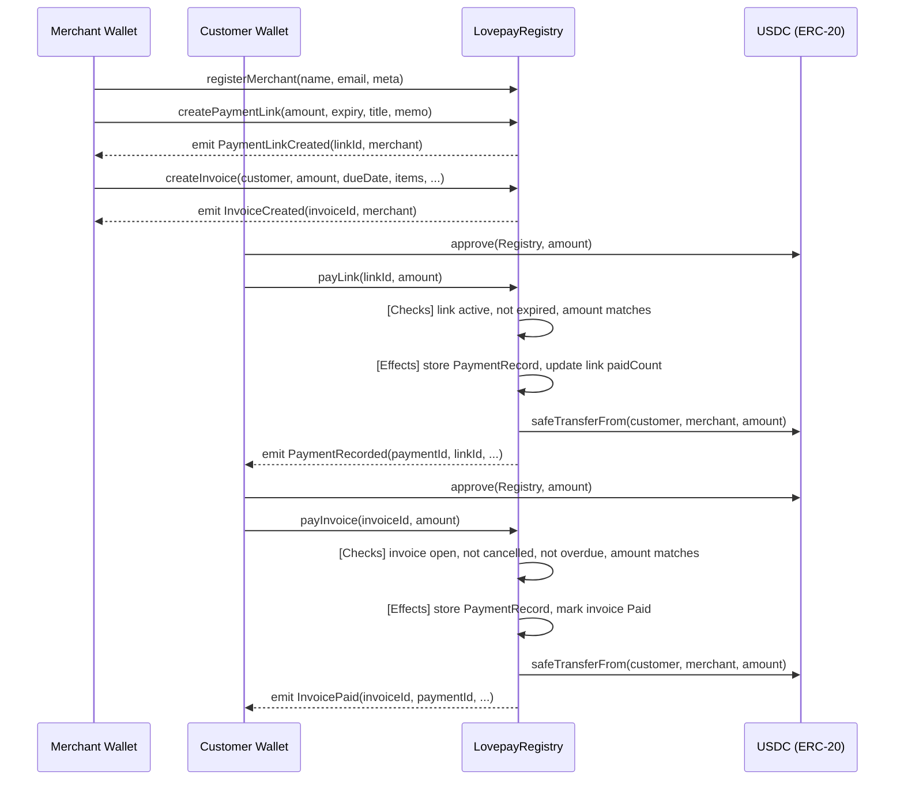

# LovepayRegistry — Smart Contract Design Document

## 1. Metadata

| Field | Value |
|---|---|
| Status | Draft |
| Authors | Arc Studio |
| Target Chain | Arc Testnet (Chain ID 5042002) |
| Language / Toolchain | Solidity 0.8.28 / Foundry (Forge) |
| Milestone | v1.0 — Testnet Launch |

**Review Tracker**

- [ ] Design Review
- [ ] Security Review (automated max-preset)
- [ ] Ops Review
- [ ] Compliance Review

---

## 2. Action Items (living)

_Empty at draft. Populated after each review round._

---

## 3. Goals / Non-Goals

### Goals

- Store merchant profiles, payment links, invoices, and payment records fully onchain on Arc Testnet.
- Allow any Ethereum address to self-register as a merchant (permissionless).
- Allow any address to record a payment against a payment link or invoice.
- Emit rich events for every state-changing action so the frontend can reconstruct full ledger history without additional backend.
- Enforce data-ownership invariants: only the merchant who created a record may update or deactivate it.
- Settle USDC payments atomically within the same transaction that records the payment.

### Non-Goals

- KYC / identity verification (out of scope for v1).
- Fiat-currency payment rails (no bank API integration onchain).
- Cross-chain bridging (single-chain only for v1).
- Upgradeability (intentionally immutable).
- Protocol fee collection (v1 has zero platform MDR).
- Front-running protection beyond standard EVM ordering (no private mempool).

---

## 4. Requirements

### Functional

- F1. Any wallet can register as a merchant with a name, email, and business details.
- F2. A merchant can create a payment link with an optional fixed amount and optional expiry timestamp.
- F3. A merchant can create an invoice with line-item metadata, tax, discount, due date, and customer info.
- F4. Any wallet can pay a payment link; USDC is transferred from payer to merchant atomically.
- F5. Any wallet can pay an invoice; USDC is transferred from payer to merchant atomically.
- F6. A merchant can deactivate a payment link or cancel an invoice.
- F7. All records are indexed by merchant address and by record ID for efficient enumeration.
- F8. Payment receipts include the payer address, amount, timestamp, and on-chain transaction reference.

### Security

- S1. Only the owning merchant address may mutate a payment link or invoice it created.
- S2. Payment amounts must exactly match the invoice or link amount when a fixed amount is set.
- S3. Expired payment links must revert.
- S4. Cancelled / fully-paid invoices must not accept further payments.
- S5. No external contract call may re-enter the contract during a payment settlement.
- S6. The contract must not retain USDC after a payment — all funds flow directly to the merchant.
- S7. Integer arithmetic on amounts must not overflow (Solidity 0.8 checked math).
- S8. No dangling max-approvals — callers must approve the exact payment amount before calling.

---

## 5. Terminology & Actors

| Term | Definition |
|---|---|
| Merchant | An Ethereum address that has called `registerMerchant`; the owner of payment links and invoices |
| Customer / Payer | Any Ethereum address that calls `payLink` or `payInvoice` |
| Payment Link | An onchain record with an optional fixed USDC amount and expiry; payable by any address |
| Invoice | An onchain record representing a bill to a specific customer with line items, tax, and due date |
| Payment Record | An immutable receipt created when a payment lands |
| USDC | The ERC-20 token at the Arc Testnet USDC address; the only accepted currency |

### Actors Table

| Actor | On/Off-chain | Trust Level | Capabilities |
|---|---|---|---|
| Merchant | On-chain EOA or contract wallet | Semi-trusted | Register self; create/deactivate payment links; create/cancel invoices |
| Customer / Payer | On-chain EOA or contract wallet | Untrusted | Approve USDC; call `payLink` or `payInvoice` |
| Contract itself | On-chain | Trusted | Reads balances; transfers USDC via `transferFrom`; emits events |
| Arc Chain / Validators | On-chain | Trusted | Ordering and finality |

---

## 6. Language / Runtime

- **Solidity 0.8.28** — checked arithmetic by default; custom errors for gas efficiency.
- **Foundry (Forge)** — build, test, deploy.
- **EVM version: Paris** — Arc Testnet runs Paris; no Cancun opcodes (`PUSH0`, `mcopy`) used.
- **OpenZeppelin 5.1.0** — `ReentrancyGuard`, `SafeERC20`; pinned to avoid `mcopy` introduced in 5.2.0.
- No upgradeable proxy: immutable deployment, no `initialize` / `_disableInitializers` needed.

---

## 7. Transaction & Execution Model

All state transitions are atomic. The two USDC-moving functions (`payLink`, `payInvoice`) follow strict CEI (Checks–Effects–Interactions) ordering:

1. **Checks** — validate inputs, record existence, status, amount, expiry.
2. **Effects** — write the payment record, update invoice/link status.
3. **Interactions** — `SafeERC20.safeTransferFrom(payer, merchant, amount)`.

`nonReentrant` is applied to both payment functions as a defense-in-depth measure against re-entrancy via the USDC token callback path (non-standard hook implementations).

The contract never holds USDC at rest (resting-state invariant: `USDC.balanceOf(address(this)) == 0`).

---

## 8. Chain Standards & Interfaces

| Interface | Details |
|---|---|
| ERC-20 consumer | Uses USDC at the Arc Testnet address via `IERC20` / `SafeERC20` |
| No token standard implemented | This is a registry and escrow-pass-through, not a token |
| EIP-712 | Not used in v1 (no off-chain signatures) |
| ERC-1271 | Not implemented; contract-wallet merchants can still call all functions directly |

---

## 9. Architecture Overview



### Flow of Funds

| Step | Who moves what | Invariant |
|---|---|---|
| Customer approves | Customer → USDC contract (approval) | Registry allowance ≥ payment amount |
| payLink / payInvoice | Registry calls `safeTransferFrom(customer, merchant, amount)` | Merchant balance increases by exactly `amount`; customer decreases by exactly `amount` |
| Post-call | No funds remain in contract | `USDC.balanceOf(Registry) == 0` at all times |

**Resting-state invariant:** The contract holds zero USDC at all times. It is a pass-through, not an escrow.

---

## 10. Contract Design

### Roles

| Role | Holder | Permissions | Rationale |
|---|---|---|---|
| Merchant | Any registered address | Create/deactivate own links; create/cancel own invoices | Permissionless self-registration |
| Payer | Any address | Pay an active link or open invoice | Permissionless |
| (No admin/owner) | — | — | Fully permissionless v1; no privileged operations |

### Storage Layout

```solidity
// --- Merchant ---
struct Merchant {
    address wallet;        // 20 bytes
    string  name;          // dynamic
    string  email;         // dynamic
    string  businessName;  // dynamic
    string  metaURI;       // dynamic (optional IPFS/Arweave URI for KYC docs)
    uint256 registeredAt;  // 32 bytes
    bool    active;        // 1 byte (packed)
}
mapping(address => Merchant) public merchants;
address[] public merchantIndex;            // enumeration

// --- Payment Link ---
enum LinkStatus { Active, Paused, Deactivated }

struct PaymentLink {
    bytes32    id;           // keccak256 of (merchant, counter)
    address    merchant;
    string     title;
    string     memo;
    uint256    amount;       // 0 = open amount (customer sets value)
    uint256    expiresAt;    // 0 = never expires
    LinkStatus status;
    uint256    paidCount;
    bool       multiUse;
    uint256    createdAt;
}
mapping(bytes32 => PaymentLink)     public paymentLinks;
mapping(address => bytes32[])       public merchantLinks;  // merchant → linkIds
uint256 public linkCounter;

// --- Invoice ---
enum InvoiceStatus { Draft, Sent, Paid, Cancelled, Overdue }

struct Invoice {
    bytes32       id;
    address       merchant;
    address       customer;       // 0x0 = open (any payer)
    string        invoiceNumber;
    uint256       amount;          // total payable (after tax/discount, in USDC units)
    uint256       dueDate;
    InvoiceStatus status;
    string        metaURI;         // IPFS/Arweave URI for line-item JSON
    uint256       createdAt;
    uint256       paidAt;
}
mapping(bytes32 => Invoice)         public invoices;
mapping(address => bytes32[])       public merchantInvoices;
uint256 public invoiceCounter;

// --- Payment Record ---
struct PaymentRecord {
    bytes32 id;
    bytes32 refId;        // linkId or invoiceId
    address payer;
    address merchant;
    uint256 amount;
    uint256 paidAt;
    bool    isInvoice;
}
mapping(bytes32 => PaymentRecord)   public paymentRecords;
mapping(address => bytes32[])       public merchantPayments;
mapping(address => bytes32[])       public payerPayments;
uint256 public paymentCounter;

// --- USDC ---
IERC20 public immutable usdc;
```

### Modifiers

| Modifier | Guard |
|---|---|
| `onlyMerchant(id)` | `msg.sender == record.merchant` |
| `nonReentrant` | Standard OZ guard on all payment functions |

### Key Functions (Write)

| Function | Caller | State mutated | Events | Reverts when |
|---|---|---|---|---|
| `registerMerchant(name, email, businessName, metaURI)` | Any address (once) | Creates `Merchant` record | `MerchantRegistered` | Already registered |
| `updateMerchant(name, email, businessName, metaURI)` | Registered merchant | Updates own record | `MerchantUpdated` | Not registered |
| `createPaymentLink(title, memo, amount, expiresAt, multiUse)` | Registered merchant | Creates `PaymentLink` | `PaymentLinkCreated` | Not registered |
| `updatePaymentLink(linkId, status)` | Link's merchant | Updates `status` | `PaymentLinkUpdated` | Not owner; invalid status |
| `createInvoice(customer, invoiceNumber, amount, dueDate, metaURI)` | Registered merchant | Creates `Invoice` | `InvoiceCreated` | Not registered; amount == 0 |
| `updateInvoiceStatus(invoiceId, status)` | Invoice's merchant | Updates `status` | `InvoiceStatusUpdated` | Not owner; cannot mark Paid (only `payInvoice` does) |
| `payLink(linkId, amount)` | Any address | Creates `PaymentRecord`; increments `paidCount`; deactivates single-use link | `PaymentRecorded` | Link inactive/expired; amount mismatch (fixed link); USDC transfer fails |
| `payInvoice(invoiceId, amount)` | Any address (or specific customer) | Creates `PaymentRecord`; sets invoice `status = Paid`, `paidAt` | `InvoicePaid`, `PaymentRecorded` | Invoice not open; amount mismatch; past due; wrong payer (if customer set); USDC transfer fails |

### Events

| Event | Indexed params | When |
|---|---|---|
| `MerchantRegistered(address indexed wallet, uint256 registeredAt)` | wallet | registerMerchant |
| `MerchantUpdated(address indexed wallet)` | wallet | updateMerchant |
| `PaymentLinkCreated(bytes32 indexed linkId, address indexed merchant, uint256 amount, uint256 expiresAt)` | linkId, merchant | createPaymentLink |
| `PaymentLinkUpdated(bytes32 indexed linkId, LinkStatus status)` | linkId | updatePaymentLink |
| `InvoiceCreated(bytes32 indexed invoiceId, address indexed merchant, address customer, uint256 amount, uint256 dueDate)` | invoiceId, merchant | createInvoice |
| `InvoiceStatusUpdated(bytes32 indexed invoiceId, InvoiceStatus status)` | invoiceId | updateInvoiceStatus |
| `PaymentRecorded(bytes32 indexed paymentId, bytes32 indexed refId, address indexed payer, address merchant, uint256 amount, bool isInvoice)` | paymentId, refId, payer | payLink / payInvoice |
| `InvoicePaid(bytes32 indexed invoiceId, bytes32 indexed paymentId, address payer, uint256 amount)` | invoiceId, paymentId | payInvoice |

---

## 11. Specification Tables

### 11.1 Registration Principles

1. One merchant record per wallet address — re-registration reverts.
2. Merchant data is mutable by the owner only.
3. Deregistration is not supported in v1 (records are permanent).

### 11.2 Payment Principles

1. A payment transfers exactly `amount` USDC from payer to merchant atomically — no partial fills.
2. The contract holds zero USDC at rest.
3. A single-use link becomes `Deactivated` immediately after its first successful payment.
4. An invoice becomes `Paid` immediately after its payment — no further payments accepted.
5. Fixed-amount links reject any `amount` argument that does not match `link.amount`.

---

## 12. Deployment & Initialization

- **Constructor args:** `address usdc_` — the Arc Testnet USDC ERC-20 address.
- **No `initialize`** — immutable; constructor sets `usdc` as `immutable`.
- **Deployer:** Arc Studio platform deployer (`0x5B12Ce46C7194aD57d143bC22847224047b1Ef42`) on first testnet deploy. Production deployer should be a multisig.
- **Init runbook:** Deploy → verify source on ArcScan → update frontend `VITE_LOVEPAY_CONTRACT` → smoke-test `registerMerchant`.

---

## 13. Upgradeability

Not applicable — immutable by design. Migration story for v2: deploy a new contract at a new address; frontend config points to the new address; old records remain readable at the old address.

---

## 14. Key Management & Signing

No off-chain signatures in v1. All privileged operations require `msg.sender` to be the owning merchant address. No EIP-712, Permit2, or meta-transactions in scope for v1.

---

## 15. Security Considerations

| Vulnerability | Applicable? | Mitigation |
|---|---|---|
| Reentrancy | Yes — `safeTransferFrom` is an external call | CEI ordering; `nonReentrant` on `payLink` and `payInvoice` |
| Access control | Yes — merchant-owned records | `onlyMerchant` check on every mutating function; verified via `msg.sender == record.merchant` |
| Integer overflow/underflow | No — Solidity 0.8 checked math | No `unchecked` blocks on amount arithmetic |
| Unchecked external call / return | Yes | `SafeERC20.safeTransferFrom` wraps and reverts on failure |
| Fee-on-transfer / rebasing tokens | Low — only Arc USDC accepted | USDC address is `immutable`; no other token accepted |
| Signature replay | N/A — no off-chain signatures in v1 | — |
| Front-running / MEV | Low — payments are not MEV-extractable (fixed recipient, fixed amount) | No mitigation needed |
| Flash-loan / price manipulation | N/A — no price oracle | — |
| Oracle manipulation | N/A | — |
| Denial of service | Low — unbounded arrays in merchant index | `merchantIndex` is append-only; enumeration is off-chain via events; no on-chain loop over it |
| Delegatecall / proxy safety | N/A — immutable | — |
| Timestamp / block dependence | Yes — expiry and dueDate use `block.timestamp` | Timestamps are user-supplied and used only for ≥ / ≤ comparisons; ±15 s miner tolerance is acceptable for payment expiry |
| Approval persistence | Low — callers approve per-tx | No max approvals stored by this contract; callers manage their own allowances |
| Centralization risk | Low — no admin role | No privileged actor; merchants own only their own data |
| Open-amount link abuse | Medium — payer sets amount | Documented: open-amount links should only be used for donation/tip flows where any amount is acceptable |

---

## 16. Trust Model & Threat Analysis

| Actor | Max damage if compromised | Mitigation | Detection |
|---|---|---|---|
| Merchant wallet | Can deactivate own links/invoices; cannot affect other merchants | No cross-merchant power; per-merchant isolation | Event monitoring on `PaymentLinkUpdated`, `InvoiceStatusUpdated` |
| Payer wallet | Can pay valid links/invoices with their own USDC | Contract only moves funds they explicitly approved | USDC `Approval` + `Transfer` events |
| No admin role | N/A | Fully permissionless | — |

---

## 17. Emergency Response & Circuit Breakers

No pause mechanism in v1 (permissionless, no admin). If a critical bug is found post-deploy:
1. Publish a warning via the frontend.
2. Deploy a patched v2 contract at a new address.
3. Redirect the frontend config to the new address.
4. Old contract remains readable; new payments go to v2.

No `Rescuable` needed: the contract holds zero USDC at rest, so there are no stuck funds to recover. If USDC is mistakenly sent directly (not via a function call), those funds are permanently lost — this is a known limitation of immutable pass-through contracts.

---

## 18. Failure Scenarios

| Scenario | Outcome |
|---|---|
| Customer approves too little USDC | `safeTransferFrom` reverts; no state change; no funds moved |
| Customer calls `payLink` on an expired link | Reverts in Checks phase; no state change |
| Merchant deactivates a link mid-payment | The deactivation and payment are on different transactions; whichever lands first wins; no partial state |
| Invoice `dueDate` passes | Merchant can call `updateInvoiceStatus(id, Overdue)`; after that `payInvoice` reverts |
| Network partition / reorg | Arc Testnet uses fast finality; reorgs are negligible; payment records are written atomically |

---

## 19. Priorities & Tradeoffs

| Decision | Tradeoff | Rationale |
|---|---|---|
| Permissionless registration | Anyone can register as a merchant | Maximizes openness; KYC is an off-chain concern for v1 |
| No platform fee | Zero protocol revenue in v1 | Simplifies contract; fee collection adds MDR logic and custody risk |
| Immutable (no proxy) | No bug-fix path except redeploy | Eliminates upgrade risk and centralization; safest for a v1 |
| `metaURI` string for invoice line items | Line items stored off-chain (IPFS/Arweave) | Onchain storage of variable-length arrays is expensive; URI pattern is standard |
| Open-amount links allowed | Payer controls amount — risk of underpayment for fixed-price goods | Intentional for tip/donation use cases; fixed-price use should set `amount > 0` |
| No `customer` enforcement on links | Any address can pay any link | Payment links are by design public; invoices can restrict to a specific customer |

---

## 20. Testing Strategy

- **Unit tests (Forge):** happy path per function; revert paths for every `require`/`revert` guard; fuzz `amount` arithmetic; event emission.
- **Invariant tests (Forge):** `USDC.balanceOf(registry) == 0` at all times; `paymentCounter` monotonically increases.
- **Static analysis (Slither):** run against source; fix all High findings before deploy.
- **Integration tests:** fork Arc Testnet; fund a test merchant; run full pay-link and pay-invoice flows end-to-end.
- **Run command:** `forge test -vvv && slither contracts/LovepayRegistry.sol`

---

## 21. Third-Party Libraries

| Library | Version | Pre-installed? | Why chosen | Security-reviewed? |
|---|---|---|---|---|
| OpenZeppelin Contracts | 5.1.0 | Yes | `ReentrancyGuard`, `SafeERC20` | Yes — audited by OZ |
| forge-std | Bundled with Foundry | Yes | Test utilities | Yes |

---

## 22. Monitoring & Alerting

| Event / Metric | Threshold | Severity | Playbook |
|---|---|---|---|
| `PaymentRecorded` not emitted after approved USDC transfer | Any occurrence | High | Check revert reason; may indicate amount mismatch or link deactivation |
| `InvoicePaid` for an already-Paid invoice | Any occurrence | Critical | Contract reverts before this can happen; if seen, investigate node RPC |
| Merchant index length > 10,000 | Informational | Low | Enumeration stays off-chain; no action needed |

---

## 23. Cross-Functional Stakeholders

| Stakeholder | Owns |
|---|---|
| Smart contract engineer | Solidity source, Foundry tests, deploy runbook |
| Frontend engineer | wagmi integration, event indexing, contract read layer |
| Security reviewer | Automated max-preset review + Slither + unit tests |
| Product owner | Feature scope, non-goals, acceptance criteria |

---

## 24. Message Encoding

N/A — single-chain contract, no cross-chain message passing.

---

## 25. Types & Enums

```solidity
enum LinkStatus   { Active, Paused, Deactivated }
enum InvoiceStatus { Draft, Sent, Paid, Cancelled, Overdue }

struct Merchant { ... }        // see §10 Storage Layout
struct PaymentLink { ... }
struct Invoice { ... }
struct PaymentRecord { ... }
```

---

## 26. Common Patterns / Worked Examples

### Pay a Fixed-Amount Payment Link

1. Merchant calls `createPaymentLink("Coffee", "Thank you", 5_000000, 0, true)` → emits `PaymentLinkCreated(linkId, merchant, 5000000, 0)`.
2. Customer calls `USDC.approve(registry, 5_000000)`.
3. Customer calls `payLink(linkId, 5_000000)`.
   - Checks: link Active, not expired, `5_000000 == link.amount`.
   - Effects: `paymentRecords[paymentId] = {...}`, `link.paidCount++`.
   - Interactions: `USDC.safeTransferFrom(customer, merchant, 5_000000)`.
   - Emits: `PaymentRecorded(paymentId, linkId, customer, merchant, 5_000000, false)`.

### Pay an Invoice

1. Merchant calls `createInvoice(customer, "INV-001", 25_000000, dueDate, "ipfs://Qm...")` → emits `InvoiceCreated`.
2. Customer calls `USDC.approve(registry, 25_000000)`.
3. Customer calls `payInvoice(invoiceId, 25_000000)`.
   - Checks: invoice status is `Draft` or `Sent`; not past due; `customer == msg.sender` or `invoice.customer == address(0)`; amount matches.
   - Effects: `invoice.status = Paid`; `invoice.paidAt = block.timestamp`; create `PaymentRecord`.
   - Interactions: `USDC.safeTransferFrom(customer, merchant, 25_000000)`.
   - Emits: `InvoicePaid(invoiceId, paymentId, customer, 25_000000)`, `PaymentRecorded(...)`.
